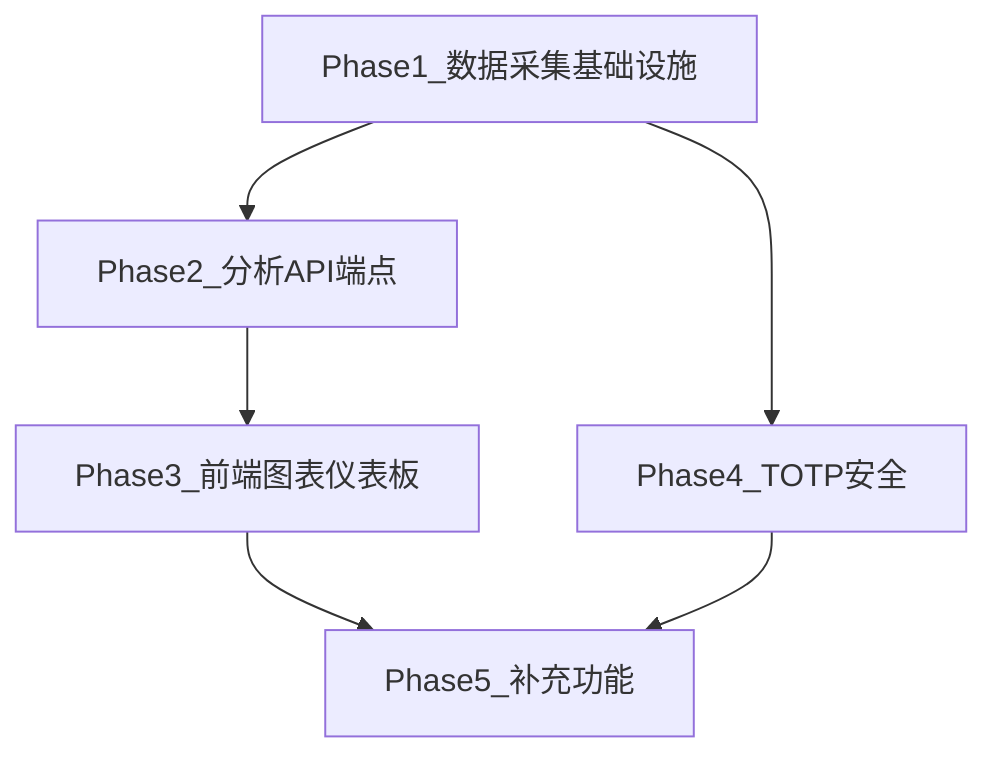

# SkyHunter Pro 管理后台数据分析与安全增强

## 当前状态

Admin 面板 (`[frontend/components/AdminPanel.tsx](frontend/components/AdminPanel.tsx)`) 目前有 4 个 Tab：Stats / Users / Monitors / Airports。Stats 仅以纯文本显示 `total_users`、`active_monitors`、`total_searches`、`scheduler_status`。无图表、无趋势分析、无成本统计、无地理分布。

后端 (`[backend/routers/admin.py](backend/routers/admin.py)`) 的 `/api/v1/admin/stats` 只返回汇总数字，无时间序列数据。

## 需要新增的功能模块

### 1. 数据采集基础设施（后端）

**新增数据库模型** (在 `[backend/models/database.py](backend/models/database.py)`)：

- `**ApiUsageLog`** -- 记录每次 API 调用
  - `user_id`, `endpoint`, `method`, `status_code`, `response_time_ms`, `ip_address`, `created_at`
  - 通过 FastAPI 中间件自动记录
- `**ApiCostRecord`** -- 记录 API 成本（SerpApi 调用费用）
  - `api_provider` (serpapi 等), `cost_usd`, `request_type` (search/monitor_check), `reference_id`, `created_at`
  - 在 `[backend/services/flight.py](backend/services/flight.py)` 中每次调用 SerpApi 时写入
- `**AdminBudget`** -- 管理员充值/预算记录
  - `amount_usd`, `description`, `provider` (serpapi_credits 等), `created_at`
  - 管理员手动录入充值金额

**修改现有模型**：

- **User 表** 新增字段：`country`(ISO 国家码), `region`, `signup_ip`, `last_login_at`, `last_login_ip`
  - 注册时通过请求 IP 推断地理位置（使用免费 IP 定位 API 或 request header）

**新增中间件** (在 `backend/core/middleware.py`)：

- 请求日志中间件：自动记录每个 API 请求到 `ApiUsageLog`

### 2. 后端分析 API 端点

在 `[backend/routers/admin.py](backend/routers/admin.py)` 或新建 `backend/routers/admin_analytics.py` 中添加：


| 端点                                                                     | 说明                     |
| ---------------------------------------------------------------------- | ---------------------- |
| `GET /api/v1/admin/analytics/overview`                                 | 仪表板概览：今日/本周/本月 KPI 卡片  |
| `GET /api/v1/admin/analytics/user-trends?range=day/week/month/quarter` | 用户注册趋势（时间序列）           |
| `GET /api/v1/admin/analytics/api-usage?range=...`                      | API 调用量趋势（按端点分组）       |
| `GET /api/v1/admin/analytics/user-activity?page=&page_size=`           | 每用户活动明细（搜索次数、监控数、积分消耗） |
| `GET /api/v1/admin/analytics/costs?range=...`                          | API 成本趋势 + 汇总          |
| `GET /api/v1/admin/analytics/geo`                                      | 用户国家/地区分布              |
| `POST /api/v1/admin/budget`                                            | 录入 API 充值/预算           |
| `GET /api/v1/admin/budget`                                             | 查看预算记录                 |


**时间范围参数**：`range` 支持 `day`（最近30天按天）、`week`（最近12周按周）、`month`（最近12月按月）、`quarter`（最近8季度按季度）。

### 3. 前端图表与仪表板

**安装依赖**：

- `react-native-svg` -- SVG 渲染基础
- `react-native-chart-kit` -- 跨平台图表（Line/Bar/Pie/Progress）

**重构 AdminPanel Tab 结构**：

```
Tabs: Dashboard | Users | Monitors | Airports | Analytics | Costs | Security
```

**Dashboard Tab（替代原 Stats）**：

- KPI 卡片行：今日新用户 / 今日 API 调用 / 今日搜索 / 活跃监控 / 调度器状态
- 用户注册趋势折线图（支持 日/周/月/季 切换）
- API 使用量柱状图
- 用户地理分布饼图

**Analytics Tab（新增）**：

- 每用户活动表格：邮箱、搜索次数、监控数、积分消耗、最后活跃时间
- 支持搜索和排序
- 热门航线 Top 10 排名

**Costs Tab（新增）**：

- 成本概览卡片：总充值、总消耗、余额、平均单次 API 成本
- 成本趋势折线图（按日/周/月）
- 充值/预算录入表单
- 消耗明细列表

**时间范围选择器**：统一的时间范围 Picker 组件（Day / Week / Month / Quarter 按钮组）

### 4. 安全：TOTP 双因素认证

**后端**：

- 安装 `pyotp`, `qrcode` 依赖
- User 模型新增：`totp_secret`(加密存储), `totp_enabled`(bool)
- 新增端点：
  - `POST /api/v1/admin/security/totp/setup` -- 生成 TOTP 密钥 + QR URI
  - `POST /api/v1/admin/security/totp/verify` -- 验证 TOTP 码并激活
  - `POST /api/v1/admin/security/totp/disable` -- 禁用 TOTP
- 修改登录流程：admin 用户若启用 TOTP，登录时需二次验证

**前端**：

- Security Tab：TOTP 开启/关闭、QR 码展示、验证码输入
- 登录页：admin 登录后弹出 TOTP 验证输入框

### 5. 我建议补充的功能

- **DAU/WAU/MAU 指标**：日活/周活/月活用户数趋势
- **系统健康监控**：API 平均响应时间、错误率
- **热门航线排名**：最多搜索/监控的出发地-目的地 Top 10
- **管理员操作审计日志**：记录所有 admin 操作（删除用户、调整积分等）
- **数据导出**：CSV 导出分析数据

## 技术选型

- **图表库**: `react-native-chart-kit` + `react-native-svg`（跨平台兼容 Web/iOS/Android）
- **IP 地理定位**: 使用请求 Header 中的地理信息 或 免费 API（如 ip-api.com），仅在注册时调用一次
- **TOTP**: `pyotp`（生成/验证）+ `qrcode`（生成 QR 图片 base64）
- **后端时间序列查询**: SQLAlchemy `func.date()` / `func.strftime()` 按时间分组聚合

## 文件改动范围

### 后端（需新增/修改的文件）

- `[backend/models/database.py](backend/models/database.py)` -- 新增 `ApiUsageLog`, `ApiCostRecord`, `AdminBudget` 模型；User 新增字段
- `backend/core/middleware.py` -- 新增 API 请求日志中间件
- `backend/routers/admin_analytics.py` -- 新增分析 API 路由
- `[backend/routers/admin.py](backend/routers/admin.py)` -- 新增 budget 端点、TOTP 端点
- `[backend/services/flight.py](backend/services/flight.py)` -- SerpApi 调用时写入成本记录
- `[backend/schemas/api_models.py](backend/schemas/api_models.py)` -- 新增分析相关 Pydantic 模型
- `[backend/main.py](backend/main.py)` -- 挂载中间件和新路由
- `[backend/requirements.txt](backend/requirements.txt)` -- 添加 `pyotp`, `qrcode`
- `[backend/config.py](backend/config.py)` -- 新增 TOTP 相关配置

### 前端（需新增/修改的文件）

- `[frontend/components/AdminPanel.tsx](frontend/components/AdminPanel.tsx)` -- 重构为多文件组件
- `frontend/components/admin/DashboardTab.tsx` -- 仪表板（KPI 卡片 + 图表）
- `frontend/components/admin/AnalyticsTab.tsx` -- 用户活动分析
- `frontend/components/admin/CostsTab.tsx` -- API 成本统计
- `frontend/components/admin/SecurityTab.tsx` -- TOTP 管理
- `frontend/components/admin/TimeRangePicker.tsx` -- 时间范围选择器
- `frontend/components/admin/KpiCard.tsx` -- KPI 指标卡片
- `[frontend/services/api.ts](frontend/services/api.ts)` -- 新增分析 API 调用
- `[frontend/types/index.ts](frontend/types/index.ts)` -- 新增分析相关类型
- `[frontend/package.json](frontend/package.json)` -- 添加 `react-native-svg`, `react-native-chart-kit`

## 实施顺序

依赖关系：数据采集 -> 分析 API -> 前端图表 -> TOTP 安全（相对独立）




1. **Phase 1**: 新增数据模型 + 中间件 + User 字段扩展 + SerpApi 成本追踪
2. **Phase 2**: 实现所有分析 API 端点
3. **Phase 3**: 安装图表库 + 重构 AdminPanel + 实现所有图表 Tab
4. **Phase 4**: TOTP 双因素认证（后端 + 前端）
5. **Phase 5**: 补充功能（DAU/WAU/MAU、审计日志、数据导出）

